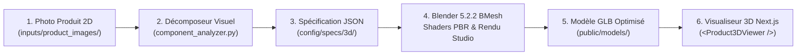

# Guide Pratique : Modélisation 3D d'Articles de Mode à partir d'Images (Pipeline Image-to-3D)

> **Nouveau :** pour transformer automatiquement les photos du catalogue en modèles 3D, quel que soit l'objet, utilisez
> le pipeline neuronal : [NEURAL_IMAGE_TO_3D.md](NEURAL_IMAGE_TO_3D.md) (`npm run 3d:catalog`). Le pipeline Blender
> décrit ci-dessous reste utile pour les gabarits procéduraux à matériaux PBR contrôlés.

Ce guide décrit comment utiliser le pipeline 3D procédural transféré depuis le studio Blender pour modéliser automatiquement et semi-automatiquement des articles de mode (maroquinerie, souliers, accessoires, bijoux, lunettes, parfums) pour la boutique en ligne.

---

## 1. Vue d'Ensemble du Flux de Travail



---

## 2. Commandes Rapides

### Option A — En Un Clic (Script PowerShell Tout-en-Un) :
Placez votre photo dans `inputs/product_images/mon_sac.jpg` puis lancez :

```powershell
powershell -ExecutionPolicy Bypass -File scripts\3d_pipeline\run_fashion_3d.ps1 -ImagePath "inputs/product_images/mon_sac.jpg" -Id "sac_cuir_noir"
```
*Cette commande exécute l'analyse, la modélisation Blender, la validation topologique, et déploie automatiquement le fichier `.glb` dans `public/models/sac_cuir_noir.glb`.*

### Option B — Étape par Étape via Python :

1. **Analyse visuelle et découpage des composants :**
```bash
& "C:\Users\WILFRIED\Downloads\Blender-5.2.2-Portable\blender-5.2.2-windows-x64\5.2\python\bin\python.exe" `
  scripts/3d_pipeline/component_analyzer.py `
  --image "inputs/product_images/mon_article.png" `
  --output "config/specs/3d/mon_article_spec.json"
```

2. **Modélisation, application des matières & export GLB :**
```bash
& "C:\Users\WILFRIED\Downloads\Blender-5.2.2-Portable\blender-5.2.2-windows-x64\blender.exe" `
  --factory-startup -b -P scripts/3d_pipeline/orchestrator.py -- `
  --spec "config/specs/3d/mon_article_spec.json" `
  --output "outputs/3d_studio/mon_article"
```

3. **Copie vers le dossier web Next.js :**
```bash
copy "outputs\3d_studio\mon_article\mon_article_decomposed.glb" "public\models\mon_article.glb"
```

---

## 3. Matériaux PBR Spécialisés pour la Mode (`materials.py`)

Le fichier `scripts/3d_pipeline/materials.py` inclut des matériaux haut de gamme configurés avec le shader physique `Principled BSDF` :

| Preset Matériau | Description & Usage |
| :--- | :--- |
| `luxury_leather_black` | Cuir de veau noir lisse avec léger reflet satiné et vernis doux. |
| `luxury_leather_cognac` | Cuir marron chaud cognac/caramel pour maroquinerie d'art. |
| `luxury_leather_bordeaux` | Cuir profond bordeaux/cerise pour sacs et escarpins. |
| `suede_nubuck` | Cuir suédé / daim velouté (fort sheen, rugosité haute). |
| `brushed_brass_gold` | Laiton doré brossé pour boucles, fermoirs et anneaux. |
| `luxury_gold_polished` | Or jaune poli miroir pour bijoux et ferrures joaillerie. |
| `polished_chrome` | Métal argenté poli pour zips et attaches modernes. |
| `satin_silk_fabric` | Tissu soyeux avec effet satiné directionnel. |
| `denim_cotton` | Toile de coton et denim texturé. |
| `crystal_perfume_glass` | Verre transparent réfraction 1.52 pour flacons de parfum. |
| `matte_rubber` | Caoutchouc noir mat pour semelles et patins. |

---

## 4. Intégration dans la Boutique Web Next.js

Un composant React interactif et fluide est préconfiguré sous `components/3d/Product3DViewer.tsx`.

### Exemple d'utilisation dans une page produit (`ProductDetail.tsx` ou modal) :

```tsx
import Product3DViewer from '@/components/3d/Product3DViewer';

export function ProductView() {
  return (
    <div className="max-w-xl mx-auto">
      <Product3DViewer
        modelSrc="/models/sac_cuir_noir.glb"
        posterSrc="/models/sac_poster.png"
        alt="Sac en Cuir Noir ELSI"
        autoRotate={true}
      />
    </div>
  );
}
```

---

## 5. Bonnes Pratiques pour Photographier un Article

1. **Fond neutre :** Placez l'article devant un fond uniforme (blanc, gris clair ou tissu uni).
2. **Éclairage doux :** Évitez les ombres portées trop dures sous les poches ou bandoulières.
3. **Vue 3/4 ou Face :** Une vue de 3/4 face permet au décomposeur de mesurer la hauteur, les largeurs de strates et la profondeur relative.
4. **Symétrie & Pose :** Posez les sacs bien droits et fermez les boucles/zips pour une silhouette nette.
